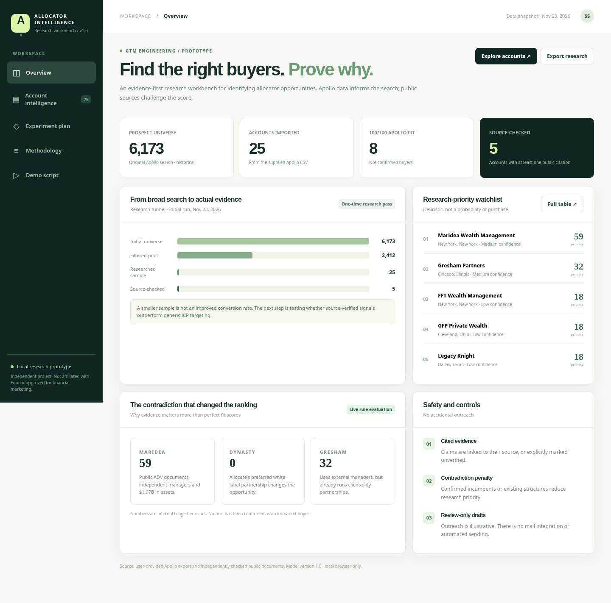
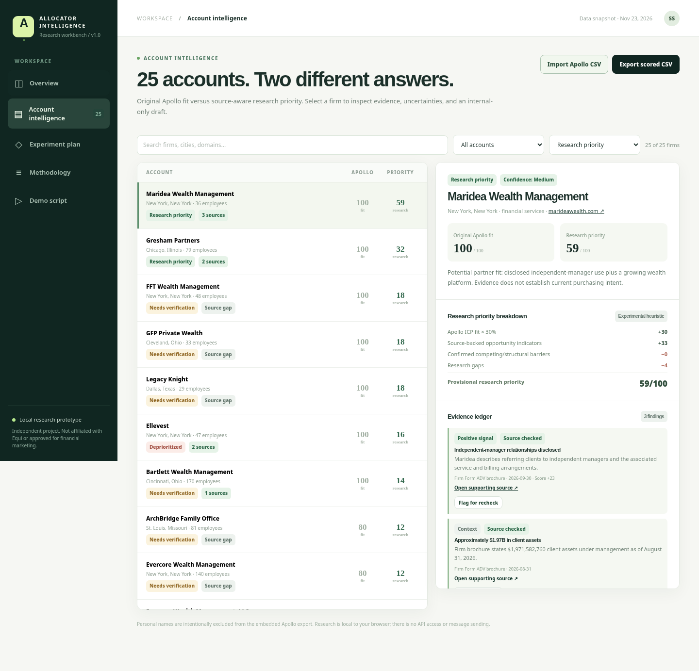
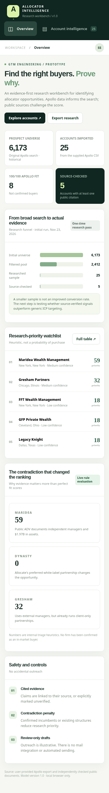
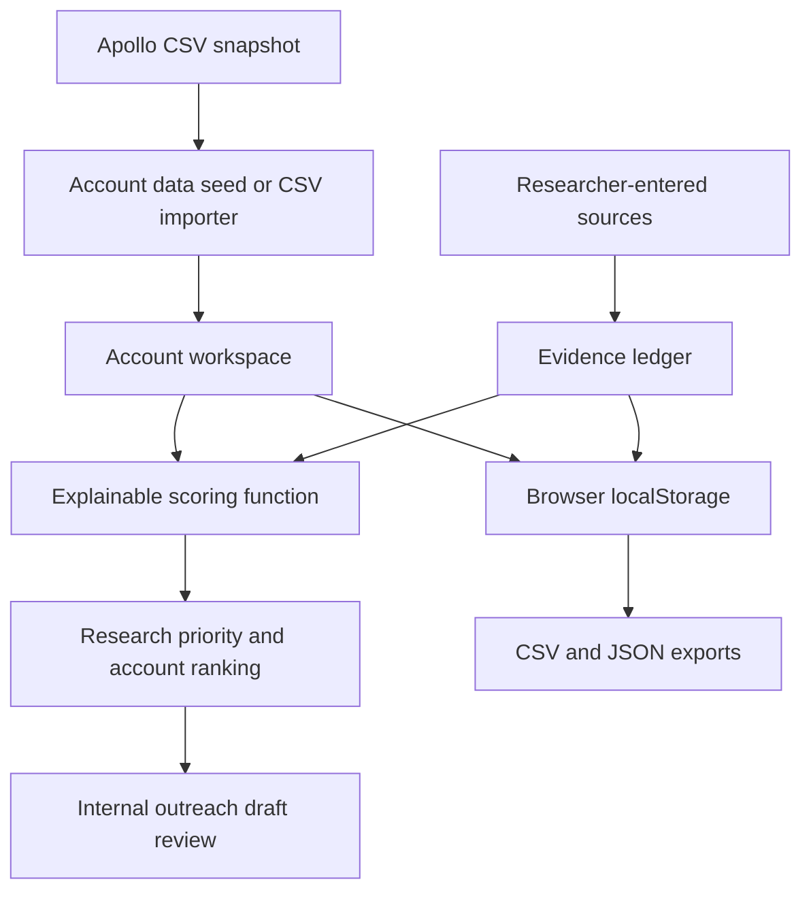

# Allocator Intelligence

**An evidence-first GTM research workbench for finding and prioritizing potential institutional investment buyers.**

Allocator Intelligence helps a researcher move beyond broad prospect lists and generic fit scores. It combines account data, cited research, competitive constraints, and an explainable scoring model to help decide **which advisory firms deserve a closer look, why, and what should be verified before outreach.**

The first working version is a standalone, browser-based application built with vanilla HTML, CSS, and JavaScript. It requires no API keys, backend, build step, or subscription to run.

> [!IMPORTANT]
> **Project status: functional research prototype, not an autonomous AI agent.** The application does not independently browse the web, call an LLM, enrich contact details, send emails, sync with Apollo, or generate measurable pipeline. It ranks supplied accounts using a transparent, rules-based heuristic and lets a human researcher review and update the evidence.
>
> This is an **independent portfolio and GTM engineering project**, originally developed around an illustrative alternative-investments prospecting challenge. It is not an Equi product and is not sponsored, endorsed, or approved by Equi.

## Contents

- [The problem](#the-problem)
- [Project goals](#project-goals)
- [Screenshots](#screenshots)
- [What works today](#what-works-today)
- [Quick start](#quick-start)
- [Using the application](#using-the-application)
- [How research scoring works](#how-research-scoring-works)
- [Research methodology and sample findings](#research-methodology-and-sample-findings)
- [Data sources and provenance](#data-sources-and-provenance)
- [Import and export](#import-and-export)
- [Architecture](#architecture)
- [Experiment design and success metrics](#experiment-design-and-success-metrics)
- [Privacy, licensing, and compliance](#privacy-licensing-and-compliance)
- [Limitations](#limitations)
- [Roadmap](#roadmap)
- [Public deployment](#public-deployment)
- [Project background](#project-background)

## The problem

Most sales intelligence workflows start by defining an ideal customer profile (ICP), searching a data provider, and ranking accounts against that profile. This is useful for narrowing a market, but it leaves a critical question unanswered:

**Is a company a good match on paper, or is there a credible reason for it to consider a new provider now?**

For example, an independent registered investment adviser (RIA) might have the right employee count and offer alternative investments. That does not establish that it needs another alternatives provider. It may already have a preferred platform partner, manufacture its own funds, or operate under a parent company's centralized purchasing program.

Allocator Intelligence separates three questions:

1. **Fit:** Does the company resemble the kind of organization we want to serve?
2. **Evidence:** What publicly documented facts support or challenge the opportunity?
3. **Next action:** What should a researcher verify before a salesperson spends time on the account?

The system is intentionally designed to *lower* a high initial score when contradictory evidence appears.

## Project goals

- Turn a broad account universe into a manageable research queue.
- Preserve the initial ICP score without treating it as purchase intent.
- Record individual findings with source URLs, dates, and classifications.
- Distinguish source-checked findings from unverified research notes.
- Surface competitive barriers and data-quality issues.
- Make every research-priority adjustment explainable.
- Prepare internal outreach angles without enabling accidental sending.
- Provide an inexpensive foundation for future agentic research and CRM integrations.

## Screenshots

The screenshots below illustrate the current local application. Screenshots and bundled sample data may contain Apollo-derived company information; review them before placing this repository in a public location.

### Overview



The overview shows the original research funnel, account counts, the research-priority watchlist, and examples of contradictory evidence.

### Account intelligence



The account workspace compares original Apollo fit with the separate research-priority score, and opens a source ledger and account detail panel.

### Mobile layout



The interface includes a responsive layout for smaller screens. The desktop experience is better suited to reviewing source-heavy account records.

## What works today

| Feature | v1.0 status | Details |
| --- | --- | --- |
| Account workspace | Working | Loads the supplied 25-account sample and displays company-level fields. |
| Search | Working | Search by firm, domain, location, and analyst summary. |
| Filtering | Working | View all accounts, those with checked sources, those needing evidence, or accounts with competitive/data-quality risks. |
| Sorting | Working | Sort by research priority, original Apollo fit, or company name. |
| Source ledger | Working | Add a finding, explanatory note, optional date, source URL, and classification. |
| Research review | Working | Mark source-linked findings as checked or flag them for recheck. |
| Research-priority scoring | Working | Scores recalculate immediately after applicable evidence changes. |
| Confidence labels | Working | Displays Low, Limited, or Medium based on source counts and positive evidence. |
| Account workflow | Working | Change research status and save analyst notes. |
| Outreach draft | Working, internal only | Creates a generic, copyable review draft only when the account has a source-checked positive signal. |
| Apollo CSV import | Working | Add or update accounts from a compatible Apollo export. |
| CSV export | Working | Download a ranked summary with scores, source URLs, and open questions. |
| JSON export | Working | Download account records and their research fields. |
| Local save | Working | Saves edits in the current browser's `localStorage`. |
| Experiment plan | Included | Outlines a potential fit-only versus evidence-first prospecting test. |
| Demo script | Included | Provides a suggested approximately 90-second product walkthrough. |
| Autonomous research agent | **Not implemented** | No scheduled crawling, live search, or LLM reasoning pipeline. |
| CRM sync or email delivery | **Not implemented** | No sending account, active outreach, or contact enrichment. |

## Quick start

### Option A: Open the self-contained version

1. Download or clone the repository.
2. Open **`standalone.html`** in a modern browser.
3. Explore **Overview**, then **Account intelligence**.

`standalone.html` packages the CSS, JavaScript, and seed records into one HTML file. You do not need Python, Node.js, a server, or an internet connection to explore the application. Opening external evidence links requires internet access.

### Option B: Open the modular version

Keep these files in the same directory:

```text
index.html
styles.css
app.js
data.js
```

Open `index.html` directly, or serve the directory with Python:

```bash
python -m http.server 8000
```

Then visit `http://localhost:8000`.

On Windows, `py -m http.server 8000` may work if Python is installed through the Python launcher.

**Requirements:** a modern browser with JavaScript enabled and support for `localStorage` and `structuredClone`. No npm installation or package manager is required.

## Using the application

### 1. Review the overview

The dashboard summarizes the initial research funnel and the active account data. Its historical funnel figures are from the original research exercise; they are **not** real-time counts fetched from Apollo.

### 2. Inspect an account

Open **Account intelligence** and select a firm. The detail panel contains:

- Original Apollo fit score.
- Current research-priority score and a complete point breakdown.
- Analyst summary and research status.
- A finding-by-finding evidence ledger.
- Outstanding verification questions.
- Analyst notes.
- An internal outreach angle when there is an eligible checked positive finding.

### 3. Add or challenge evidence

Under **Add a source or challenge the ranking**:

1. Enter a finding title.
2. Explain exactly what the source establishes.
3. Paste an HTTP(S) URL and optionally supply the source date.
4. Classify the finding as **Opportunity signal**, **Competitive barrier**, or **Neutral context**.
5. Check **I inspected this source and confirmed the claim** only when you have actually reviewed the underlying page or filing.
6. Save the finding.

The score updates immediately if the finding is marked checked and carries a valid URL. Notes without checked sources remain visible but do not contribute to opportunity or risk points.

**Important:** The checkbox records a researcher's assertion. The application validates URL format, but it does not retrieve the webpage or prove that the source supports the claim.

You can also flag a finding for recheck or delete findings added manually. Seeded findings can be toggled but are not removable through the existing interface.

### 4. Triage the research queue

Change an account's research status to one of:

- **Needs verification**
- **Research priority**
- **Competitive barrier**
- **Data quality issue**
- **Deprioritized**

These workflow statuses are separate from the numeric score. Only the **Data quality issue** status contributes an additional numeric penalty.

### 5. Review an internal outreach draft

A draft becomes available when an account has at least one checked, valid-URL **positive** finding. It uses a generic research-oriented message and a placeholder signature, `[Authorized Equi representative]`.

The application can copy this text but has **no Send button, email integration, sequence enrollment, or automatic delivery**. Any real outreach would require an authorized sender, independently checked recipient information, and appropriate financial-marketing review.

### 6. Export or reset

Use **Export scored CSV** for a ranked summary or **Export research** for JSON with complete account/evidence objects.

The **Reset to imported data** control restores the original built-in seed dataset and discards edits saved in that browser. Export first if you want to retain your work.

## How research scoring works

### Two scores, two jobs

**Original Apollo fit** is the imported 0 to 100 ICP score from the research exercise. That original scoring pass considered alternatives activity, the existence of an investment team, public or regulatory evidence, and firm type. It is preserved as imported data, not recalculated by this application.

**Research priority** is this application's own 0 to 100 *work-queue heuristic*. It combines a portion of Apollo fit with researcher-checked findings and explicit penalties. It is not a statistically trained propensity model.

### Exact v1.0 formula

```text
Base score       = round(clamp(Apollo fit, 0, 100) * 0.30)
Positive points  = min(55, sum(checked positive evidence points))
Risk points      = min(45, sum(checked negative evidence points))
Research gap     = 4 if at least one valid, checked source exists, otherwise 12
Quality penalty  = 8 if status is "Data quality issue", otherwise 0

Research priority = clamp(
  Base score + Positive points - Risk points
  - Research gap - Quality penalty,
  0,
  100
)
```

Here, **checked evidence** means a finding marked `verified: true` with a valid HTTP(S) source URL. Neutral context is displayed but adds no points.

| Component | Range | Purpose |
| --- | --- | --- |
| Imported Apollo fit | 0 to 30 | Preserves firmographic relevance without dominating the decision. |
| Checked positive findings | 0 to +55 | Rewards documented reasons to research the account. |
| Checked competitive constraints | 0 to -45 | Penalizes incumbents and structural obstacles. |
| Evidence gap | -12 or -4 | Prevents an unresearched account from appearing highly qualified. |
| Entity-quality issue | 0 or -8 | Penalizes identified company-identity or data-quality problems. |

**New user-added findings** currently receive fixed weights: +12 for an opportunity signal, -18 for a competitive barrier, and 0 for neutral context. The original seeded evidence has individually assigned weights based on the initial research exercise. These are judgment-based defaults, not empirically calibrated estimates.

### Example: Why a perfect fit score can collapse

Dynasty Financial Partners entered the sample with an Apollo fit score of 100. A checked public announcement identified Allocate as a preferred white-label private-markets provider, creating a competitive constraint for a potentially overlapping offering.

```text
Apollo fit contribution:     round(100 * 0.30) = +30
Positive checked evidence:                       +0
Competitive partnership penalty:                -27
Evidence gap penalty:                            -4
----------------------------------------------------
Research priority:                       clamp(-1) = 0
```

A score of 0 here means **deprioritized under this particular heuristic**. It does not prove the company would never buy a complementary product or that an exclusive agreement exists.

### Confidence is separate from priority

The displayed confidence label is computed from valid source-checked items:

| Label | Rule |
| --- | --- |
| **Low** | No valid checked source. |
| **Limited** | At least one valid checked source, but not enough qualifying positive evidence for Medium. |
| **Medium** | At least two valid checked sources, including at least one positive finding. |

These labels describe the **density of checked sources in the prototype**, not statistical confidence, legal verification, or confidence that a company will purchase.

## Research methodology and sample findings

### Research funnel

The original research exercise, dated **November 23, 2026**, used Apollo to narrow an account universe:

```text
6,173  Initial US wealth-management and investment-services matches
2,412  Refined search pool after size, category, and exclusion filters
   25  Exported and first-pass researched accounts
    8  Accounts initially scoring 100/100 in Apollo fit
    5  Accounts annotated with public-source findings in this demo
```

Those are discovery and research counts. The 25 accounts are not 25 validated buyers; the funnel is not a marketing conversion funnel.

### Initial search criteria

- US-headquartered investment management and financial-services companies.
- Approximately 25 to 500 employees after refinement.
- Keywords such as wealth management, registered investment adviser, and family office.
- Banking, insurance, directories, and industry associations excluded by the research query.

The subsequent research looked for external manager selection, alternative-investment offerings, vendor and parent-company relationships, and public evidence that might strengthen or weaken a specific commercial hypothesis.

### Research examples

| Account | What changed our interpretation | Practical takeaway |
| --- | --- | --- |
| **Maridea Wealth Management** | Its public advisory brochure describes independent-manager relationships and reports approximately $1.97 billion in client assets as of August 31, 2026. | Plausible external-manager research opportunity. No live purchasing intent established. |
| **Dynasty Financial Partners** | Allocate announced an expanded relationship and preferred white-label private-markets position in June 2026. | A documented competitive barrier should affect prioritization. |
| **Gresham Partners** | Its Form CRS discusses outside managers and Gresham-advised private partnerships. | Potential manager-access buyer, but with existing sophisticated internal structures. |
| **Bartlett Wealth Management** | Focus's corporate directory places Bartlett within its broader network. | Verify where provider-selection authority actually resides. |
| **Ellevest** | Its wealth-management page already describes private investment access. | An apparent product gap may disappear after checking the company website. |

These examples illustrate **research considerations**, not verified current needs, commercial relationships with this project, or an endorsement of the target accounts. Verify the linked materials again before using any fact externally.

### Selected public-source references

- [Maridea Form ADV Part 2A, September 2026](https://marideawealth.com/wp-content/uploads/2026/10/ADV2A_Maridea_20260930.pdf)
- [Maridea announcement of its Pultro acquisition, September 2026](https://marideawealth.com/press/maridea-wealth-management-acquires-pultro-financial-management/)
- [Allocate and Dynasty expanded partnership announcement, June 2026](https://www.allocate.co/news/allocate-and-dynasty-financial-partners-expand-partnership-to-power-private-market-access-and-solutions-business-wire)
- [Gresham Form CRS, March 2025](https://reports.adviserinfo.sec.gov/crs/crs_108668.pdf)
- [Focus Partners listing for Bartlett Wealth Management](https://corporate.focuspartners.com/locations/bartlett-wealth-management)
- [Ellevest wealth management](https://www.ellevest.com/wealth-management)
- [Industry coverage of Envestnet's investment in Ellevest](https://www.wealthmanagement.com/wealth-management-industry-trends/envestnet-takes-stake-in-sallie-krawcheck-s-ellevest)

The detailed Apollo AI research narratives and their original citations were **not** embedded in the uploaded CSV. The application deliberately does not invent missing citations, decision-maker names, or verified email addresses.

## Data sources and provenance

There are three distinct sources of information:

1. **Apollo account export:** Company metadata and initial Apollo fit scores, imported from a supplied CSV snapshot.
2. **Public documentation:** A small set of company disclosures, regulatory documents, and announcements seeded as individually classified findings.
3. **Researcher updates:** User-entered findings, notes, and classifications saved locally in the browser.

Fields such as `fit`, `description`, `employees`, and `domain` originate from account data. Fields such as `evidence`, `unknowns`, and `analyst` carry additional interpretation and must not be mistaken for verified account facts unless supported by a checked source.

The shipped sample contains **25 accounts, 10 evidence entries across 5 annotated accounts, and 9 initially marked source-checked entries**. The remaining accounts need further independent research.

## Import and export

### Import an Apollo CSV

Select **Account intelligence → Import Apollo CSV** and choose a compatible CSV file.

Recognized input fields include:

| Column | Used for |
| --- | --- |
| `Company Name` | Required account identity. |
| `Apollo Account Id` | Match existing accounts when populated. |
| `Website` | Company URL and derived domain. |
| `Company City`, `Company State`, `Company Country` | Location. |
| `# Employees` | Employee count. |
| `Industry` | Industry. |
| `Short Description` | Company description. |
| A column starting with `Equi Platform Fit Score` | Imported fit score. |

The importer matches records by Apollo account ID when available, otherwise by company name. For existing records, it updates the fit score and website when supplied while preserving research evidence. Newly imported accounts are created with empty evidence ledgers and a **Needs verification** status.

This is an Apollo-specific CSV import, **not a generic importer for every CRM or a scheduled Apollo integration**. It does not add contact enrichment or send data to Apollo.

### Export results

**Scored CSV** includes company, website, employees, original fit, research priority, confidence label, status, checked evidence count, positive points, competitive penalties, checked source URLs, and open research questions.

**JSON** includes the full active account objects, including research findings, analyst notes, manually added buyer fields, and any imported account data. Inspect JSON before sharing it publicly.

### Local persistence

Changes are stored under the browser `localStorage` key:

```text
allocator-intelligence-v1-20261123
```

Data is local to that browser and origin. It does not automatically sync between machines, GitHub clones, or deployments. Clearing browser site data can remove edits. Export a JSON snapshot before resetting, moving browsers, or clearing local data.

The current app **exports** JSON but does not have a JSON re-import feature. Its built-in import control accepts Apollo CSV files.

## Architecture

### Technology

- **HTML5** for the application shell and semantic structure.
- **Vanilla JavaScript** for rendering, scoring, importing/exporting, and interactions.
- **CSS3** for layout, visual styling, and responsive behavior.
- **Browser `localStorage`** for client-side persistence.
- **FileReader-style browser file access via `File.text()`**, `Blob`, and object URLs for import/export.

No React, Node runtime, database, server-side endpoints, LLM SDK, API tokens, or external JavaScript libraries are required by v1.0.

### Repository files

```text
allocator-intelligence/
├── README.md                 # Project documentation
├── index.html                # Main application shell for static hosting
├── app.js                    # UI, scoring, evidence, storage, import/export
├── styles.css                # Layout and responsive styles
├── data.js                   # Browser-readable seeded account dataset
├── accounts.json             # Structured version of the same seed dataset
├── standalone.html           # Self-contained HTML bundle for offline viewing
├── build_seed.py             # Optional script used to create the initial data seed
├── TAKE_HOME_BRIEF.md        # Original role-specific project framing
├── overview.png              # Desktop dashboard screenshot
├── accounts.png              # Account intelligence screenshot
└── mobile.png                # Mobile screenshot
```

`build_seed.py` is a **one-off data preparation utility**, not an application dependency. Its current source uses absolute local `/mnt/data/...` paths and expects the original Apollo CSV and a particular fit-score column. Change those paths and verify permissions before reusing it. Do not assume it is a portable production data pipeline.

### Data flow



The arrows represent local application operations, not live external API connections. Links to evidence pages open in a separate browser tab when selected.

### Key implementation details

- User-entered text is escaped before insertion into rendered HTML.
- Evidence URL handling accepts `http:` and `https:` schemes.
- Scores are recalculated in the browser by `scoreParts()`.
- The research-confidence label is computed separately by `confidence()`.
- `rank()` sorts the active account collection by current research priority.
- `makeDraft()` is a template, not an LLM-generated email.
- CSV export includes basic spreadsheet-formula injection protection for cells beginning with formula-like characters.
- The interface has no authentication or multiuser permissions model.

## Experiment design and success metrics

The central hypothesis is:

> **An account selected with current, verifiable buyer context will be more likely to generate a qualified conversation than a similar account selected using firmographic fit alone.**

The built-in **Experiment plan** sketches an eventual authorized pilot:

| Cohort | Selection strategy | Suggested initial size |
| --- | --- | --- |
| Control | ICP and firmographic fit only | 10 accounts |
| Test | Similar fit, plus checked opportunity signals and competitor screening | 10 accounts |

The small cohort sizes are suitable for testing the *workflow* and collecting qualitative feedback, not making reliable statistical claims. A larger evaluation would be required to estimate uplift.

Suggested metrics for an employer-approved implementation:

- **Research coverage:** Percentage of accounts with current, credible sources.
- **Qualification accuracy:** Percentage of reviewed recommendations accepted by a human analyst.
- **False-positive rate:** Accounts promoted despite an incumbent, unsuitable business model, or insufficient evidence.
- **Time to research:** Researcher minutes per account before and after automation.
- **Relevant replies:** Responses that demonstrate a relevant investment-platform conversation.
- **Qualified meetings:** Meetings with verified decision-makers that meet a predefined acceptance standard.
- **Pipeline attribution:** Opportunities connected to approved campaigns and CRM events.

The current experiment scoreboard is **intentionally empty**. No messages have been sent, no meetings booked through this software, and no revenue impact demonstrated.

## Privacy, licensing, and compliance

### Before publishing the repository publicly

> [!CAUTION]
> **The current repository package is not automatically safe for a public release.** `data.js`, `accounts.json`, and `standalone.html` embed Apollo-derived company records, and the screenshots may show company-specific research. Apollo data and exports may be governed by account terms and redistribution restrictions.

For a public release:

1. Replace the Apollo-derived seed records with **synthetic examples** or independently gathered data you have rights to redistribute.
2. Regenerate **all three** embedded data representations: `data.js`, `accounts.json`, and `standalone.html`.
3. Check screenshots, exported files, and commit history for Apollo-derived records or private prospect research.
4. Remove any contact details, personal notes, credentials, secrets, or employer-specific material.
5. Reassess whether `TAKE_HOME_BRIEF.md` belongs in a public portfolio repository while a hiring process is active.
6. Add a license only after deciding which parts of the code and data you have the rights to license.

**No open-source license is included by default.** Making a repository public does not itself grant permission to reuse all contents, particularly third-party data.

### Client-side data is not private storage

Browser storage is not encrypted by this application. Do not use it as a vault for personal contact information, confidential client records, credentials, or sensitive investment data. A publicly deployed static version has no login or access controls.

### Investment marketing and outreach

This application is a research and engineering demonstration. It does not provide investment advice, recommend investments to investors, or act as an SEC compliance system.

An SEC-registered investment adviser or other regulated entity considering a production deployment would need its own legal and compliance review covering, as applicable:

- Accuracy and substantiation of public-facing claims.
- Approval workflows and recordkeeping for marketing material.
- Permission and lawful handling of contact and account data.
- Review of automated copy before publication or sending.
- Vendor and integration security.
- Rules applicable to the firm's actual products, channels, and jurisdiction.

Checking **Source checked** in this prototype is **not** regulatory approval. The draft text is never authorized to be sent merely because the interface makes it copyable.

## Limitations

This release deliberately trades automation breadth for inspectability.

1. **Research is manual.** No crawler, scheduler, source monitoring, or live web-verification engine is integrated.
2. **There is no LLM pipeline.** Scoring and outreach drafting are deterministic JavaScript rules and templates.
3. **Scoring is subjective.** Evidence weights are unvalidated. High scores do not imply confirmed buying intent, probability of purchase, or forecastable revenue.
4. **The initial sample is small.** The 25 accounts are a working research sample, not an unbiased market dataset.
5. **Research coverage is uneven.** Only five seeded accounts have source annotations in the first release.
6. **Source checking is human-declared.** A valid URL is not proof that the claim is accurate, current, or material.
7. **There is no contact enrichment.** Names and verified contact information from the original deep dive were not reproduced in the seed.
8. **Drafts are templates.** They are not recipient-specific AI-generated copy and are not approved for sending.
9. **No multiuser collaboration.** Changes are local to one browser, with no authentication, shared database, or audit backend.
10. **No measured GTM outcomes.** No live outbound test, meetings, opportunities, conversion lift, or revenue has been produced by the prototype.

## Roadmap

The goal is to evolve the research workbench into an explainable GTM intelligence workflow, not to automate low-quality mass outreach.

### Phase 1: Public-safe foundation

- [ ] Replace proprietary seed records with a redistribution-safe demo dataset.
- [ ] Add a clear data dictionary and documented dataset rights.
- [ ] Add automated tests for scoring, imports, exports, and evidence states.
- [ ] Make data preparation portable instead of relying on local absolute paths.
- [ ] Add JSON re-import and a clear backup/restore workflow.
- [ ] Publish a static demo with an unambiguous independent-project disclaimer.

### Phase 2: Research automation

- [ ] Retrieve public SEC IAPD/Form ADV information through an approved, maintainable source.
- [ ] Monitor opted-in company newsrooms, announcements, and approved external datasets.
- [ ] Extract dated, attributable claims with an LLM into structured evidence records.
- [ ] Include source freshness, entity resolution, duplicate detection, and contradiction checks.
- [ ] Queue new or changed findings for human review before they affect outreach.

### Phase 3: Production GTM operations

- [ ] Add authorized CRM integrations and account ownership.
- [ ] Implement organization-specific approval roles and audit logs.
- [ ] Review drafts against approved messaging and compliance policies.
- [ ] Add deduplication, suppression controls, and contact permission checks.
- [ ] Track qualified meetings, accepted opportunities, and CRM attribution.
- [ ] Evaluate research accuracy and commercial outcomes against a defined control cohort.

Nothing in the roadmap is claimed as implemented in v1.0.

## Public deployment

The project is static and can be hosted on GitHub Pages or another static host **after preparing a safe public dataset**.

A conventional GitHub Pages setup uses `index.html` as the entry point with `app.js`, `styles.css`, and `data.js` in the same published directory. In the repository settings, enable Pages deployment from the desired branch and root folder if that option is available for your repository and plan.

**Do not deploy the current seed files publicly without reviewing the data rights and any confidential material.** Even a private repository does not guarantee that a separately published Pages site is private.

## Project background

Allocator Intelligence grew out of a practical GTM engineering question: *Can we identify firms that might have an actual reason to engage with an alternative-investment provider, rather than simply collecting thousands of superficially relevant accounts?*

The initial Apollo research revealed why the distinction matters. Multiple firms scored 100 out of 100 on ICP fit, yet follow-up research surfaced existing platform relationships, internal investment capabilities, and uncertain purchasing authority. A good research workflow should preserve that contradiction instead of hiding it.

The current application is the first working version of that idea: a place to examine account evidence, revise a ranking, and document the reasoning before anyone acts on it.

**Built independently as a GTM engineering portfolio project through Useful in Practice.**

For more on the broader research and software work, visit [Useful in Practice](https://stephenstilwell.com).
